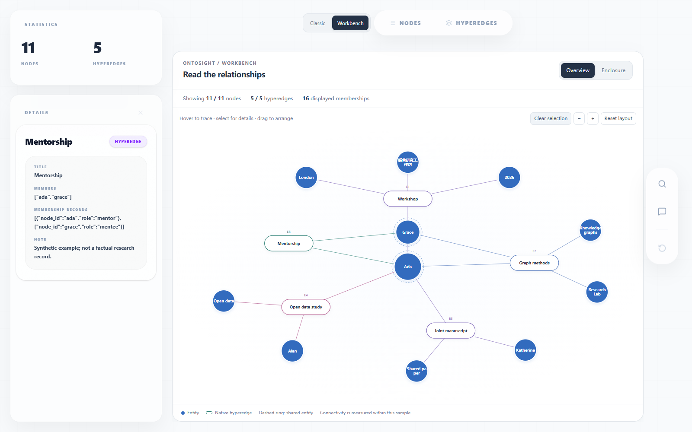
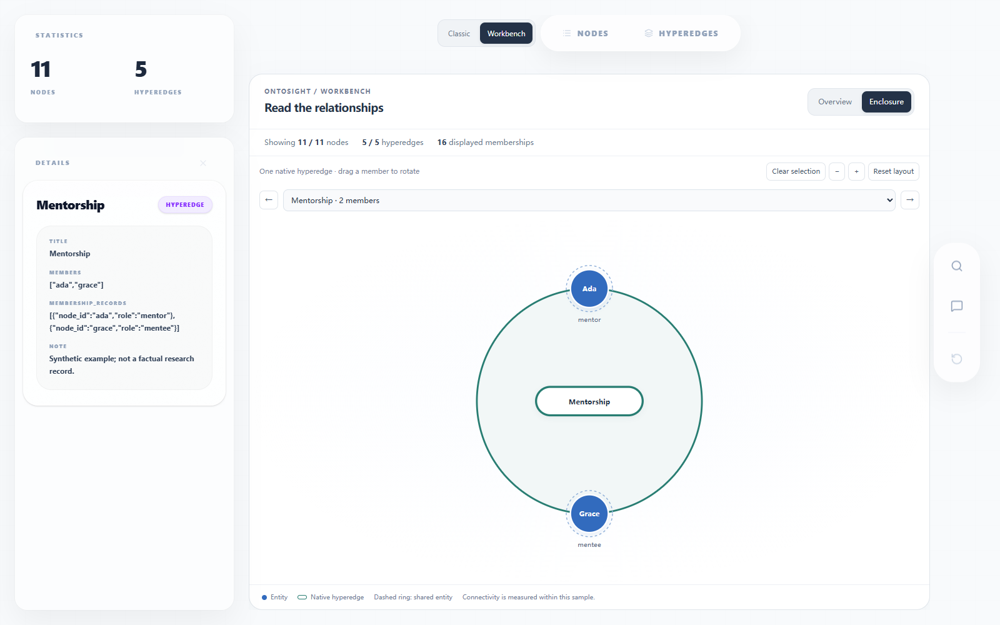

# Hypergraph Workbench

Workbench is an optional presentation style for `view_hypergraph`. Classic remains
the default. Select **Workbench** in the lower-right style picker; no Python API
change is needed. Classic's existing navigation and sidebar stay in their original
positions. Workbench places its style picker next to the navigation bar.

| Capsule overview | Single-hyperedge enclosure |
| --- | --- |
|  |  |

## Views and controls

- **Overview** draws entities as blue circles and native hyperedges as labelled
  capsules. Each line represents one entity's membership in a hyperedge. A dashed
  ring marks an entity belonging to multiple displayed hyperedges.
- **Enclosure** displays one native hyperedge at a time. All its displayed members
  lie on one boundary, including hyperedges with only two members. Select a node
  to browse its incident hyperedges, or select a hyperedge directly.
- Hover to trace memberships, click or press Enter/Space to open existing details,
  and drag entities to arrange the overview. In Enclosure, dragging rotates the
  member ring. The selector and arrow buttons navigate hyperedges.
- Use **+ / −** to zoom and scroll the canvas to inspect a larger layout.
  **Reset layout** restores geometry while keeping the current sample and selection.
  The existing global **Reset** tool still fetches a new sample and clears history.

Switching Classic/Workbench preserves the displayed response, highlighted search
or chat results, selected ID, details cache, and browsing history. Workbench starts
with a fresh arrangement when it is remounted. The selected Workbench subview lasts
for the browser session; refreshing the page restores Classic.

## Data contract

The renderer reads OntoSight's existing `nodes`, `hyperedges[].linked_nodes`,
`data.label`, `data.raw`, and `highlighted` fields. It does not treat the auxiliary
`edges` used by Classic's force layout as independent pairwise facts. Distinct
hyperedge IDs remain distinct even when their labels match. Duplicate endpoint IDs
within one hyperedge are drawn once.

OntoSight normally returns a sampled neighborhood. The header separates displayed
counts from global counts supplied by `/api/meta`. Degree, shared-node rings, and
membership counts describe the displayed sample. Missing endpoint references are
reported and omitted from the drawing; no substitute nodes are invented. Selecting
an item outside a later search sample retains its history and shows a notice.

Optionally, a hyperedge's `data.raw.membership_records` may supply roles as
`[{"node_id": "ada", "role": "author"}]`. Enclosure displays those explicit values.
No roles, provenance, or direction are inferred from node order or labels.

## Run the synthetic demo from this checkout

Create and activate a Python virtual environment first:

```bash
python -m venv .venv
# Windows PowerShell: .\.venv\Scripts\Activate.ps1
# macOS/Linux: source .venv/bin/activate
python -m pip install -e ".[dev]" httpx
cd frontend
npm ci
npm run build
cd ..
python examples/workbench_demo.py
```

Open `http://127.0.0.1:8000`, then select Workbench. The demo contains 11 entities,
5 hyperedges, and 16 memberships. Search for `Mentorship`, or ask the chat panel
about `Ada`. Both callbacks are deterministic local examples; they require no model,
API key, or external data. All collaborations are synthetic.

The existing API client is unchanged and defaults to `http://localhost:8000`.
To use a custom demo port, set the existing build-time `VITE_API_URL` to that server's
complete URL before `npm run build`, then run the demo with the matching `--port`.

## Verification

With the Python environment activated and the frontend built:

```bash
python -m pytest
cd frontend
npm test -- --run
npx playwright install chromium
npm run test:e2e
```

Playwright starts and stops the synthetic demo automatically. To test a demo already
running, set `ONTOSIGHT_TEST_URL` to its complete URL. `ONTOSIGHT_BROWSER` can point
to an installed Chrome/Chromium executable. Browser tests cover both renderers,
selection and details, search/chat callbacks, native membership counts, keyboard
selection, dragging, layout reset, and a narrow viewport. Screenshots are written
to the ignored `temp/` directory.

This first version targets interactive reading of sampled hypergraphs. Dense
overviews may still overlap and can be rearranged or read through Enclosure. There
is no new extraction pipeline, LLM backend, offline export, or large-graph performance
claim in this contribution.

## Implementation and attribution

The style addition leaves the Python library, server endpoints, storage, public
frontend API types/client, Classic renderer, and search/chat components unchanged.
A separately reviewable one-line details fix gives repeated history rows distinct
React keys. Repeated selection could otherwise leave an older item at the top;
the existing history contents and ordering rules are preserved. A browser test
reproduces this through Classic's existing gallery. Workbench uses a local input type for the existing native
membership payload. Its layout styles apply only while Workbench is selected;
the new style entry is the only intentional addition to the initial Classic page.

`frontend/src/components/views/workbench/model.ts` adapts the existing API payload;
`layout.ts` computes deterministic display positions; `WorkbenchHypergraphView.tsx`
renders SVG and delegates selection to OntoSight's existing Zustand store.

The capsule overview, single-edge enclosure, and native membership reading approach
are adapted from [hanxiangmin/Hyper-Knowledge](https://github.com/hanxiangmin/Hyper-Knowledge)
at commit `913ee64a3b8962395ff8a11e0e84b55aacfc743c`, particularly
`hyperknowledge/visualization/html.py`, under Apache-2.0. The adaptation rewrites the
presentation as React/TypeScript components for OntoSight. Hyper-Knowledge is not
a runtime dependency. OntoSight and this contribution retain the repository's
[Apache-2.0 license](../LICENSE).
